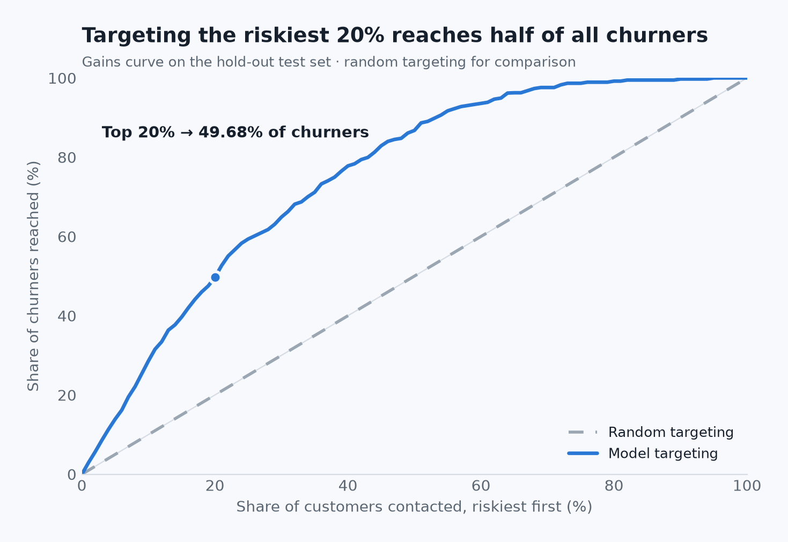

# Customer Churn Analytics

Analisis *end-to-end* terhadap dataset sampel *customer churn* IBM Telco: menggunakan SQL dan pandas untuk menemukan konsentrasi churn, model scikit-learn bebas *data leakage* untuk memeringkat pelanggan berisiko, serta dashboard Streamlit yang mengubah skor tersebut menjadi daftar prioritas retensi dan simulasi *backtest* kampanye yang transparan.

Dataset ini merupakan sampel publik IBM dengan 7.043 pelanggan, dan 26,54% di antaranya berhenti berlangganan. Analisis menunjukkan bahwa pelanggan kontrak bulanan pada tahun pertama merupakan sumber churn terbesar, sehingga program retensi sebaiknya diprioritaskan ke segmen tersebut dan ke pelanggan dengan skor risiko tertinggi.

## Demo


## Permasalahan Bisnis

Sebuah bisnis berbasis langganan kehilangan **1.869 dari 7.043 pelanggan (26,54%)** pada snapshot data ini. Pelanggan yang berhenti tersebut mewakili **\$139.130,85 pendapatan bulanan — 30,50% dari total pendapatan bulanan sebesar \$456.116,60**. Karena anggaran retensi terbatas, bisnis perlu menjawab tiga pertanyaan utama:

1. **Di mana** konsentrasi churn terbesar terjadi? (analisis tingkat segmen)
2. **Siapa** pelanggan yang harus dihubungi tim retensi terlebih dahulu? (pemeringkatan tingkat pelanggan)
3. **Berapa potensi imbal hasil kampanye** dengan asumsi biaya dan tingkat keberhasilan yang transparan?

Proyek ini menjawab ketiga pertanyaan tersebut dengan bukti yang dapat direproduksi.

## Rekomendasi

| Aksi | Target | Alasan (Bukti Data) |
|---|---|---|
| Tawarkan kontrak tahunan dengan insentif loyalitas | Pelanggan kontrak bulanan (**3.875** pelanggan, churn **42,71%**) | Jenis kontrak adalah pembeda churn terbesar; tingkat churn kontrak 2 tahun hanya **2,83%** |
| Bangun program *onboarding* dan *check-in* 90 hari pertama | Masa berlangganan 0–12 bulan (**2.186** pelanggan, churn **47,44%**) | Hampir separuh pelanggan tahun pertama mengalami churn; turun menjadi **9,51%** setelah 48 bulan |
| Bundel Tech Support / Online Security ke paket internet | Pelanggan internet tanpa *add-on* (**3.473** tanpa Tech Support, churn **41,64%**) | Pengguna *add-on* memiliki churn jauh lebih rendah: **15,17%** (Tech Support) dan **14,61%** (Online Security) |
| Dorong pengguna *electronic check* beralih ke pembayaran otomatis | Pengguna *electronic check* (**2.365** pelanggan, churn **45,29%**) | Churn pembayaran kartu kredit otomatis hanya **15,24%** |
| Prioritaskan daftar pelanggan berisiko tinggi dari model | Kontrak bulanan + fiber optic + tenure ≤ 12 bulan (**916** pelanggan, churn **70,20%**) | Segmen ini menyumbang **38,22%** dari seluruh pendapatan bulanan yang hilang akibat churn |

Temuan di atas bersifat **asosiasi, bukan hubungan sebab-akibat yang terbukti**. Sebagai contoh, pelanggan yang memilih Tech Support mungkin memang sudah lebih loyal sejak awal; uji coba lapangan (*A/B test*) diperlukan untuk memvalidasi dampak nyata.

## Pemodelan

**Fitur.** `tenure`, `MonthlyCharges`, `TotalCharges` (diskalakan) ditambah seluruh kolom kategorikal kecuali `customerID`, `gender`, dan `Churn` (*one-hot encoding* dengan `handle_unknown="ignore"`). Kolom `gender` sengaja dikecualikan karena tidak dapat ditindaklanjuti dan tidak memberikan sinyal tambahan yang berarti. Seluruh prapemrosesan dibungkus dalam satu `Pipeline` scikit-learn, sehingga *scaler* dan *encoder* hanya dilatih di dalam masing-masing *fold* validasi silang dan tidak pernah melihat data validasi/uji.

**Kandidat Model.** Logistic Regression (`class_weight="balanced"`), Random Forest (`class_weight="balanced_subsample"`, `min_samples_leaf=5`), dan Histogram Gradient Boosting (`class_weight="balanced"`).

**Seleksi Model.** 5-fold stratified CV ROC-AUC **hanya pada data latih** (5.634 baris). Data uji (1.409 baris) dievaluasi tepat satu kali setelah model terpilih.

| Model | CV ROC-AUC |
|---|---|
| **Logistic Regression (terpilih)** | **0,8462 ± 0,0125** |
| Random Forest | 0,8444 ± 0,0089 |
| Histogram Gradient Boosting | 0,8372 ± 0,0071 |

Ketiga model menghasilkan skor yang praktis setara — selisihnya lebih kecil dari satu standar deviasi — sehingga model paling sederhana dan paling mudah dijelaskan dipilih. Kompleksitas *ensemble* tambahan tidak memberikan peningkatan performa yang signifikan.

**Metrik Data Uji (ambang batas 0,5).**

| Metrik | Nilai |
|---|---|
| ROC-AUC | **0,8418** |
| PR-AUC | **0,6325** (*baseline* tanpa model: 0,2654) |
| Precision | **0,5026** |
| Recall | **0,7834** |
| F1 | **0,6123** |

| Confusion Matrix | Prediksi Tidak Churn | Prediksi Churn |
|---|---|---|
| **Aktual Tidak Churn** | 745 | 290 |
| **Aktual Churn** | 81 | 293 |

Bobot kelas (*class weights*) mendorong model ke arah *recall*: model berhasil menangkap **78,34%** pelanggan yang benar-benar churn, meskipun sekitar separuh pelanggan yang ditandai sebenarnya tidak churn. *Trade-off* ini disengaja karena pada kasus retensi, kehilangan pelanggan umumnya jauh lebih mahal daripada biaya menghubungi pelanggan ekstra.

**Kurva Gains (data uji).** Menghubungi **10%** pelanggan paling berisiko menjangkau **28,58%** total churner; **20%** teratas menjangkau **49,68%** (dibandingkan 20% jika acak); **30%** teratas menjangkau **64,89%**.



**Faktor pendorong skor.** *Permutation importance* pada data uji (penurunan ROC-AUC ketika fitur diacak): `tenure` **0,1561**, `InternetService` **0,0432**, `MonthlyCharges` **0,0410**, `Contract` **0,0394**.


**Skor dashboard menggunakan *out-of-fold*.** Tabel `customer_scores` dihasilkan menggunakan `cross_val_predict`: setiap pelanggan dinilai oleh model yang dilatih pada *fold* lain, tidak pernah melihat label churn milik pelanggan itu sendiri. Dashboard menggunakan skor ini agar pemeringkatan tidak bias. Model akhir kemudian dilatih pada seluruh 7.043 baris dan disimpan ke `models/churn_model.joblib`.

## Dashboard

Terdiri dari empat tab dengan filter sidebar untuk kontrak, layanan internet, dan masa berlangganan (*tenure*). Jika kombinasi filter menghasilkan data kosong, aplikasi menampilkan peringatan alih-alih menggambar grafik kosong yang menyesatkan.

1. **Overview** — empat KPI utama (jumlah pelanggan, tingkat churn, pendapatan bulanan yang hilang, proporsi pendapatan hilang) serta grafik tingkat churn berdasarkan kontrak, tenure, metode pembayaran, dan layanan internet. Setiap grafik dilengkapi garis rata-rata keseluruhan dan label nilai langsung.
2. **At-risk customers** — daftar pelanggan aktif (belum churn) di atas ambang batas risiko yang dapat diatur lewat *slider*. Pada ambang default 0,50, tampil **1.419 pelanggan aktif** dengan **\$106.360** pendapatan bulanan berisiko. Tabel diurutkan berdasarkan risiko, dilengkapi rekomendasi aksi berbasis aturan, dan tombol unduh CSV.
3. **Retention campaign backtest** — simulasi menghubungi pelanggan dari risiko tertinggi ke terendah. Dengan pengaturan default dashboard (\$25 per kontak, tingkat keberhasilan 25%, 12 bulan pendapatan terselamatkan), porsi kontak optimal berada di **55,6%** dengan hasil bersih **\$288.758**; aturan tetap **20%** menghasilkan **\$196.814** dibandingkan **\$48.243** untuk penargetan acak. Seluruh asumsi dapat diubah melalui *slider* dan angka finansial dinyatakan secara eksplisit sebagai skenario.
4. **Predict a customer** — formulir input profil pelanggan yang menjaga konsistensi kombinasi fitur (misalnya "No internet" otomatis mengatur seluruh *add-on* ke "No internet service"; "No phone" mengatur Multiple Lines ke "No phone service"). Menampilkan skor risiko, persentil terhadap seluruh 7.043 pelanggan, dan rekomendasi aksi.

Skor berfungsi untuk **memeringkat** risiko, bukan probabilitas terkalibrasi. Penggunaan *class weights* menaikkan rata-rata skor (rata-rata skor OOF 0,4144 dibanding tingkat churn aktual 26,54%), sehingga skor 0,70 berarti "lebih berisiko dibanding mayoritas pelanggan", bukan "peluang churn 70%".

## Tech Stack

Python 3.14 · pandas 3.0 · NumPy · scikit-learn 1.9 · SQLite (`sqlite3`) · matplotlib · Plotly · Streamlit · joblib

## Struktur Proyek

```
.
├── app.py                  # Dashboard Streamlit (4 tab)
├── sql/queries.sql         # 9 kueri bisnis bernama
├── src/
│   ├── common.py           # Path, daftar fitur, pipeline sklearn bersama
│   ├── prepare.py          # Pembersihan CSV → tabel SQLite `customers`
│   ├── train.py            # Perbandingan model, evaluasi uji, skor OOF
│   └── analysis.py         # Eksekusi SQL → tabel CSV + grafik README
├── data/                   # CSV mentah; churn.db dihasilkan oleh pipeline
├── models/                 # churn_model.joblib dihasilkan oleh pipeline
├── reports/                # metrics.json, perbandingan model, importance, tables/
├── assets/                 # Grafik evaluasi model & demo GIF dashboard
├── tests/test_app.py       # Pengujian otomatis AppTest untuk dashboard
├── requirements.txt
├── LEARNING_NOTES.md       # Catatan alasan di balik setiap keputusan teknis
└── README.md
```

## Cara Menjalankan

```bash
python -m venv .venv
source .venv/bin/activate
pip install -r requirements.txt

mkdir -p data
curl -L -o data/telco_customer_churn.csv \
  https://raw.githubusercontent.com/IBM/telco-customer-churn-on-icp4d/master/data/Telco-Customer-Churn.csv

python -m src.prepare     # bersihkan data + muat ke SQLite
python -m src.train       # bandingkan model, evaluasi uji, simpan artefak
python -m src.analysis    # hasilkan tabel SQL + grafik

streamlit run app.py
```

Menjalankan pengujian:

```bash
python -m pytest tests -q
```

Seluruh proses menggunakan `random_state=42`; menghapus `data/churn.db`, `models/`, dan `reports/` lalu menjalankan ulang ketiga modul akan menghasilkan metrik yang identik.

## Catatan Metode & Keterbatasan

- **Bebas *data leakage*.** Pemisahan train/test dilakukan sebelum *fitting* apa pun; *scaling* dan *one-hot encoding* dilakukan di dalam pipeline pada setiap *fold* CV. Seleksi model hanya memakai data latih, dan data uji disentuh sekali. Skor dashboard menggunakan *out-of-fold* agar tidak bias oleh label pelanggan sendiri.
- **Pembersihan data.** Terdapat 11 nilai `TotalCharges` yang kosong; seluruhnya memiliki `tenure = 0` (baru mendaftar dan belum ditagih). Nilai tersebut diisi **0** (bukan rata-rata kolom), disertai *assertion* yang memastikan seluruh baris kosong memiliki `tenure = 0` dan `customerID` bersifat unik.
- **Asosiasi bukan kausalitas.** Kontrak, fiber optic, Tech Support, dan tenure berkorelasi dengan churn, tetapi analisis observasional tidak membuktikan hubungan sebab-akibat. Eksperimen terkontrol atau *uplift modeling* merupakan langkah lanjutan yang tepat.
- **Data snapshot tanpa validasi waktu.** Dataset tidak memiliki kolom tanggal, sehingga pemisahan acak dapat mencampur pola lintas periode. Hasil mengukur kemampuan pemeringkatan dalam snapshot ini, bukan kestabilan performa di kuartal mendatang.
- **Backtest kampanye menggunakan asumsi.** Biaya \$25 per kontak, tingkat keberhasilan 25%, dan 12 bulan pendapatan terselamatkan adalah input skenario, bukan hasil pengukuran nyata. Porsi kontak optimal dipilih pada kurva yang sama sehingga cenderung optimistis; aturan tetap 20% merupakan acuan keputusan yang lebih konservatif.
- **Skor belum terkalibrasi.** Skor baik untuk pemeringkatan risiko (ROC-AUC 0,8418), namun belum berupa probabilitas eksak. Kalibrasi diperlukan jika bisnis ingin menghitung nilai ekspektasi per pelanggan.
- **Tanpa *hyperparameter tuning* ekstensif.** Kandidat model menggunakan parameter default yang wajar; skor CV yang sangat berdekatan menunjukkan *tuning* tidak akan mengubah kesimpulan secara signifikan.
- **Dataset sampel publik IBM.** Data ini adalah sampel publik, bukan data perusahaan nyata. Angka yang ditampilkan bertujuan mengilustrasikan metode analisis.
- **`gender` dikecualikan.** Tidak dapat ditindaklanjuti secara bisnis, tidak menambah sinyal prediktif, dan berpotensi menimbulkan isu keadilan (*fairness*) jika dipakai untuk penargetan.

## Sumber Data

IBM Telco Customer Churn sample (7.043 baris, 21 kolom):
<https://raw.githubusercontent.com/IBM/telco-customer-churn-on-icp4d/master/data/Telco-Customer-Churn.csv>

Halaman dataset asli: IBM Sample Data Sets — Telco Customer Churn.

## Reproduksibilitas

Seluruh angka laporan pada README ini berasal dari berkas di folder `reports/` yang dihasilkan oleh perintah di atas. Menjalankan ulang seluruh pipeline (`prepare` → `train` → `analysis`) dari kondisi bersih menghasilkan metrik yang identik; lihat `LEARNING_NOTES.md`.
