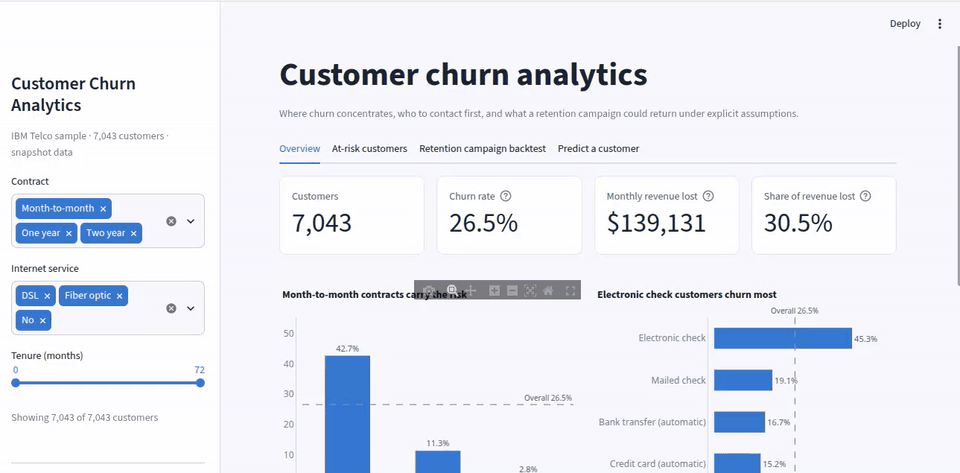
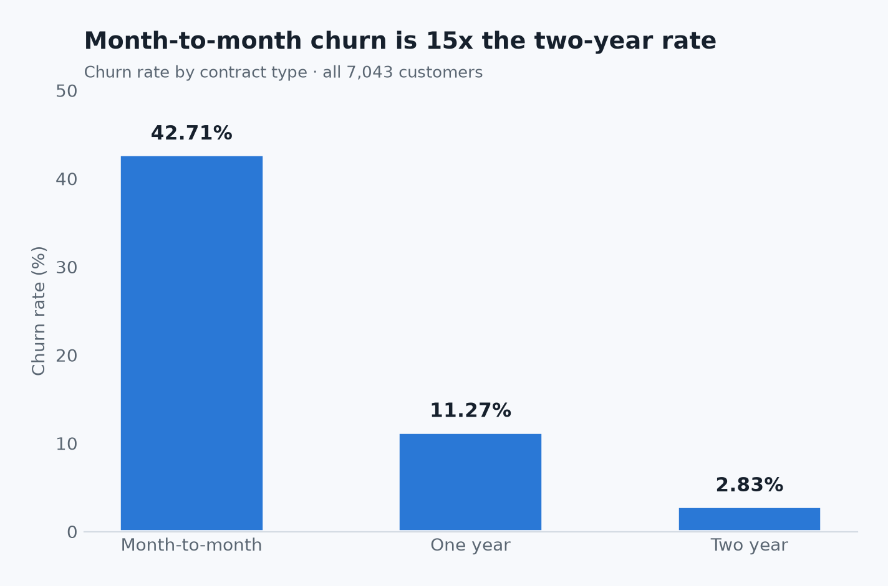
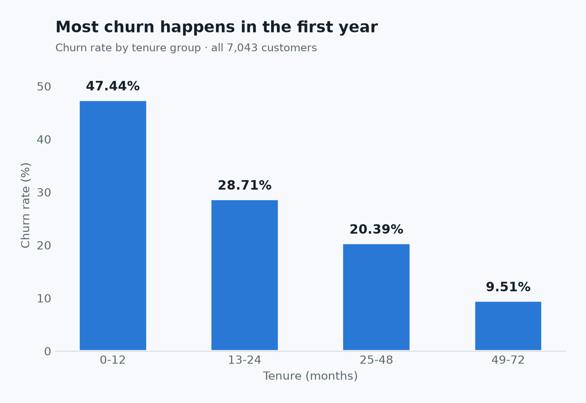
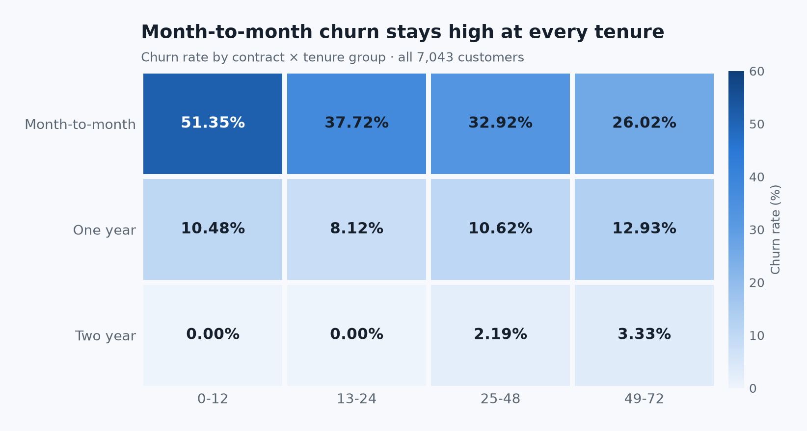
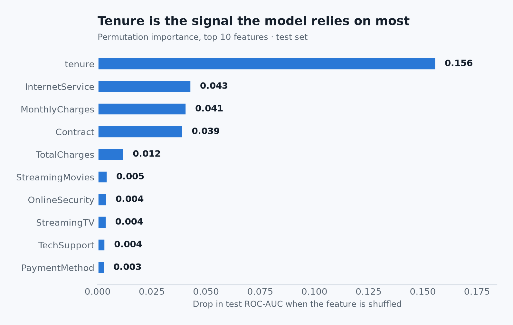

# Customer Churn Analytics

An end-to-end analysis of the IBM Telco customer churn sample: SQL and pandas to find
where churn concentrates, a leakage-safe scikit-learn model to rank who is at risk, and
a Streamlit dashboard that turns those scores into a retention worklist and a
transparent campaign backtest.

Dataset ini adalah sampel publik IBM dengan 7.043 pelanggan, dan 26,54% di antaranya
berhenti berlangganan. Analisis menunjukkan bahwa pelanggan kontrak bulanan pada tahun
pertama adalah sumber churn terbesar, sehingga program retensi sebaiknya diprioritaskan
ke segmen tersebut dan ke pelanggan dengan skor risiko tertinggi.

## Demo



## Business problem

A subscription business loses **1,869 of 7,043 customers (26.54%)** in this snapshot.
Those customers represent **$139,130.85 of monthly charges — 30.50% of the $456,116.60
total monthly revenue**. Retention spending is finite, so the business needs to answer
three questions:

1. **Where** does churn concentrate? (segment-level analysis)
2. **Who** should the retention team contact first? (customer-level ranking)
3. **What could a campaign return** under explicit cost and success assumptions?

This project answers all three and keeps the evidence reproducible.

## Key findings

**1. Contract length is the strongest split in the data.**
Month-to-month customers churn at **42.71%**, versus **11.27%** on one-year and **2.83%**
on two-year contracts — roughly **15.1×** the two-year rate.



**2. Churn is front-loaded.**
**47.44%** of customers in their first 12 months churn, compared with **28.71%** at
13–24 months and **9.51%** after 48 months.



**3. Payment method and internet product matter.**
Electronic check customers churn at **45.29%**, versus **15.24%** for credit-card
automatic payment. Fiber optic customers churn at **41.89%**, versus **18.96%** for DSL
and **7.40%** for customers with no internet service.

**4. Support add-ons are associated with much lower churn.**
Among internet customers, churn is **41.64% without Tech Support vs 15.17% with it**,
and **41.77% without Online Security vs 14.61% with it**.

**5. Revenue risk is concentrated in one segment.**
Month-to-month fiber optic customers account for **$100,482.00 of churned monthly
revenue — 72.22% of all churned monthly revenue**. The narrower high-risk segment
(month-to-month + fiber optic + tenure ≤ 12 months) contains **916 customers, 643 of
whom churned (70.20%)**, carrying **$53,178.30** per month — **38.22%** of all churned
monthly revenue.



The heatmap shows the interaction: month-to-month churn falls from **51.35%** in the
first year to **26.02%** after 48 months, but stays far above the two-year rates
(**0.00%** to **3.33%**) at every tenure.

## Recommendations

| Action | Target | Why (evidence) |
|---|---|---|
| Offer an annual contract with a loyalty credit | Month-to-month customers (**3,875** customers, **42.71%** churn) | Contract is the largest observed split; the two-year rate is **2.83%** |
| Build a first-90-days onboarding and check-in program | Tenure 0–12 months (**2,186** customers, **47.44%** churn) | Nearly half of first-year customers churn; the rate falls to **9.51%** after 48 months |
| Bundle Tech Support / Online Security into internet plans | Internet customers without the add-ons (**3,473** without Tech Support, **41.64%** churn) | Add-on holders churn at **15.17%** (Tech Support) and **14.61%** (Online Security) |
| Move electronic-check payers to automatic payment | Electronic check customers (**2,365**, **45.29%** churn) | Automatic credit card churn is **15.24%** |
| Work the model's ranked at-risk list first | Month-to-month + fiber + tenure ≤ 12 (**916** customers, **70.20%** churn) | The segment carries **38.22%** of churned monthly revenue |

These are **associations, not proven causes**. For example, customers who choose
Tech Support may already be more engaged; a trial is a hypothesis to test, not a
guaranteed lift.

## The model

**Features.** `tenure`, `MonthlyCharges`, `TotalCharges` (scaled) plus every categorical
column except `customerID`, `gender` and `Churn` (one-hot encoded with
`handle_unknown="ignore"`). `gender` is excluded on purpose: it is not actionable and
adds no useful signal. Preprocessing lives inside one sklearn `Pipeline`, so the scaler
and encoder are fitted inside each cross-validation fold and never see held-out data.

**Candidates.** Logistic regression (`class_weight="balanced"`), random forest
(`class_weight="balanced_subsample"`, `min_samples_leaf=5`) and histogram gradient
boosting (`class_weight="balanced"`).

**Selection.** 5-fold stratified CV ROC-AUC **on the training set only** (5,634 rows).
The test set (1,409 rows) was scored once, after selection.

| Model | CV ROC-AUC |
|---|---|
| **Logistic regression (selected)** | **0.8462 ± 0.0125** |
| Random forest | 0.8444 ± 0.0089 |
| Histogram gradient boosting | 0.8372 ± 0.0071 |

The three models are effectively tied — the gap is smaller than one standard deviation —
so the simplest and most explainable model was selected. Extra ensemble complexity did
not buy measurable performance here.

**Test-set metrics (threshold 0.5).**

| Metric | Value |
|---|---|
| ROC-AUC | **0.8418** |
| PR-AUC | **0.6325** (no-skill baseline: 0.2654) |
| Precision | **0.5026** |
| Recall | **0.7834** |
| F1 | **0.6123** |

| Confusion matrix | Predicted no churn | Predicted churn |
|---|---|---|
| **Actual no churn** | 745 | 290 |
| **Actual churn** | 81 | 293 |

Class weights push the model towards recall: it finds **78.34%** of churners, but about
half of the customers it flags do not churn. That is a deliberate trade-off for a
retention use case where a missed churner is usually more expensive than an extra
contact.

**Gains curve (test set).** Contacting the riskiest **10%** reaches **28.58%** of
churners; the top **20%** reaches **49.68%** (versus 20% for random); the top **30%**
reaches **64.89%**.


**What drives the score.** Permutation importance on the test set (drop in ROC-AUC when
a feature is shuffled): `tenure` **0.1561**, `InternetService` **0.0432**,
`MonthlyCharges` **0.0410**, `Contract` **0.0394**.



**Dashboard scores are out-of-fold.** `customer_scores` is produced with
`cross_val_predict`: every customer is scored by a model trained on the other folds,
never on their own churn label. The dashboard uses these scores, so no customer is
ranked by a model that already knew their outcome. The final model is then fitted on all
7,043 rows and saved to `models/churn_model.joblib`.

## Dashboard

Four tabs, with sidebar filters for contract, internet service and tenure. An empty
filter stops with a warning instead of drawing misleading empty charts.

1. **Overview** — four KPIs (customers, churn rate, monthly revenue lost, share of
   revenue lost) and churn-rate bars by contract, tenure, payment method and internet
   service. Each chart has a dashed overall-rate line and direct value labels.
2. **At-risk customers** — active (not churned) customers above a risk slider. At the
   default 0.50 threshold it shows **1,419 active customers** and **$106,360** monthly
   revenue at risk. The table is sorted by risk, adds a rule-based suggested action and
   offers a CSV download.
3. **Retention campaign backtest** — contact customers from highest to lowest risk.
   With dashboard defaults ($25 per contact, 25% success, 12 months of revenue kept),
   the best contact share is **55.6%** with a net of **$288,758**; a fixed **20%**
   contact rule returns **$196,814** versus **$48,243** for random targeting. Every
   assumption is a slider and the money figures are explicitly a scenario.
4. **Predict a customer** — enter a profile; the form forces consistent combinations
   ("No internet" sets all add-ons to "No internet service"; "No phone" sets Multiple
   Lines to "No phone service"). It shows the score, the percentile against all 7,043
   customers and a suggested action.

Scores **rank** risk; they are not calibrated probabilities. Class weights inflate the
average score (mean OOF risk 0.4144 against a 26.54% churn rate), so a 0.70 means
"higher than most customers", not "70% chance of churn".

## Tech stack

Python 3.14 · pandas 3.0 · NumPy · scikit-learn 1.9 · SQLite (`sqlite3`) ·
matplotlib · Plotly · Streamlit · joblib

## Project structure

```
.
├── app.py                  # Streamlit dashboard (4 tabs)
├── sql/queries.sql         # 9 named business queries
├── src/
│   ├── common.py           # paths, feature lists, shared sklearn pipeline
│   ├── prepare.py          # clean CSV → SQLite `customers`
│   ├── train.py            # model comparison, test evaluation, OOF scores
│   └── analysis.py         # run SQL → CSV tables + README charts
├── data/                   # raw CSV; churn.db is generated
├── models/                 # churn_model.joblib is generated
├── reports/                # metrics.json, comparison, importance, tables/
├── assets/                 # README charts and dashboard demo GIF
├── tests/test_app.py       # AppTest checks for the dashboard
├── requirements.txt
├── LEARNING_NOTES.md       # why each decision was made
└── README.md
```

## How to run

```bash
python -m venv .venv
source .venv/bin/activate
pip install -r requirements.txt

mkdir -p data
curl -L -o data/telco_customer_churn.csv \
  https://raw.githubusercontent.com/IBM/telco-customer-churn-on-icp4d/master/data/Telco-Customer-Churn.csv

python -m src.prepare     # clean + load SQLite
python -m src.train       # compare models, evaluate once, save artefacts
python -m src.analysis    # SQL tables + charts

streamlit run app.py
```

Checks:

```bash
python -m pytest tests -q
```

Everything uses `random_state=42`; deleting `data/churn.db`, `models/` and `reports/`
and rerunning the three modules reproduces the same metrics.

## Method notes and limitations

- **No leakage.** The train/test split happens before any model fitting; scaling and
  one-hot encoding are fitted inside the pipeline, within each CV fold. Model selection
  uses only the training set, and the test set is touched once. Dashboard scores are
  out-of-fold, so they are not inflated by each customer's own label.
- **Data cleaning.** 11 `TotalCharges` values are blank; all 11 have `tenure = 0`
  (signed up but not billed). They are set to **0**, not to the column mean, and
  assertions prove that every blank row has tenure 0 and that `customerID` is unique.
- **Associations are not causes.** Contract, fiber optic, Tech Support and tenure are
  correlated with churn; none of these analyses proves that changing one changes churn.
  A controlled experiment or uplift model is the right next step.
- **Snapshot data, no time validation.** The dataset has no dates, so a random split can
  put "future-looking" patterns in training. The results measure ranking skill within
  this snapshot, not performance next quarter. There is also no way to validate that
  the score is stable over time.
- **Campaign backtest uses assumed costs and success.** $25 per contact, 25% offer
  success and 12 months of retained revenue are inputs, not measurements. The "best
  share" is chosen on the same curve it is reported on, so it is optimistic; the fixed
  20% figure is the more honest decision rule.
- **Scores are not calibrated.** They rank risk well (ROC-AUC 0.8418) but should not be
  read as exact probabilities. Calibration is the next step if the business needs
  expected-value calculations per customer.
- **No hyperparameter search.** The candidates use sensible defaults; the close CV
  scores suggest tuning is unlikely to change the conclusion materially.
- **IBM sample dataset.** This is a public sample, not real data from a real company.
  Numbers illustrate the method and should not be presented as an actual company's
  results or used to target real people.
- **`gender` excluded.** It is not actionable, contributes no useful signal, and using
  it for targeting would raise fairness concerns.

## Data source

IBM Telco Customer Churn sample (7,043 rows, 21 columns):
<https://raw.githubusercontent.com/IBM/telco-customer-churn-on-icp4d/master/data/Telco-Customer-Churn.csv>

Original dataset page: IBM Sample Data Sets — Telco Customer Churn.

## Reproducibility

All report values in this README come from files in `reports/` produced by the commands
above. The full pipeline (prepare → train → analysis) was rerun from a clean state and
produced identical metrics; see `LEARNING_NOTES.md`.
